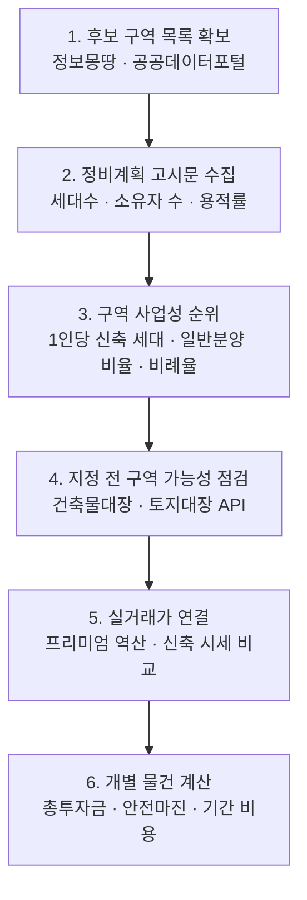

# 🏗️ 재개발 구역 평가 가이드

> 재개발 구역 평가에 쓰이는 주요 분석법을 정리하고, 지표마다 **어떤 공공데이터로 확인하는지**를 연결한 문서입니다.

<sub>최종 업데이트: 2026-11-01 · 서울시 기준</sub>

> [!IMPORTANT]
> 이 문서는 학습과 참고를 위한 자료이며 투자 권유가 아닙니다. 공모 기준과 제도는 해마다 바뀌므로 최신 공고문과 고시문으로 다시 확인하세요. 공식 기준이 아닌 경험치에는 🧪 표시를 붙였습니다.

---

## 📑 목차

1. [한눈에 보기: 4가지 질문](#1-한눈에-보기-4가지-질문)
2. [주요 분석법](#2-주요-분석법)
3. [지표별 데이터 확인법](#3-지표별-데이터-확인법)
   - [① 될 곳인가](#-될-곳인가--구역-지정-가능성)
   - [② 돈이 되는가](#-돈이-되는가--구역-사업성)
   - [③ 언제 되는가](#-언제-되는가--속도와-위험)
   - [④ 내 물건이 남는가](#-내-물건이-남는가--개별-수익)
4. [데이터 분석 순서](#4-데이터-분석-순서)
5. [데이터 출처 모음](#5-데이터-출처-모음)
6. [주의할 점](#6-주의할-점)
7. [참고 자료](#7-참고-자료)

---

## 1. 한눈에 보기: 4가지 질문

재개발 구역 평가는 아래 4가지 질문으로 정리할 수 있습니다.


| 축 | 질문 | 핵심 지표 | 평가 단위 |
|:--:|---|---|:--:|
| **①** | 구역 지정 요건을 갖췄고 주민이 원하는가 | 노후도, 접도율, 과소필지, 호수밀도, 동의율 | 구역 |
| **②** | 새로 짓고 팔아서 남는가 | 비례율, 일반분양 비율, 조합원 1인당 신축 세대 수, 용적률 | 구역 |
| **③** | 지금 어느 단계이고 걸림돌은 무엇인가 | 사업단계, 조합 분쟁, 공사비, 규제 | 구역 |
| **④** | 이 가격에 사도 되는가 | 감정가, 프리미엄(P), 분담금, 신축 시세 | 물건 |

> [!TIP]
> ③은 시간 비용입니다. 사업이 늦어질수록 ②와 ④에서 계산한 수익이 줄어듭니다.

---

## 2. 주요 분석법

| 분석법 | 출처 | 핵심 내용 |
|---|---|---|
| **신속통합기획 정량평가** | 서울시 공모 기준 | 노후도와 구역면적을 필수 요건으로 보고, 접도율·과소필지·호수밀도·반지하 비율을 선택 요건으로 봅니다. 여기에 동의율 가점과 감점이 붙습니다. "될 곳인가"를 판단할 때 사실상 표준입니다. |
| **비례율 분석** | 도시정비법상 관리처분 구조 | 구역 사업성을 나타내는 대표 지표입니다. 100%를 넘으면 조합원에게 유리합니다. |
| **추정분담금 산식** | 서울시 정비계획 고시 | 조합원 분양가에서 권리가액을 빼서 분담금을 구합니다. |
| **총투자금 대비 신축 시세** | 투자 실무 | 프리미엄 금액만 보지 않고, 매매가와 분담금을 더한 총투자금을 주변 신축 시세와 비교합니다. |
| **조합원 수 대비 일반분양** | 투자 커뮤니티, 학술연구 | 조합원이 적고 일반분양이 많을수록 분담금이 줄어듭니다. 서울 31개 구역 연구는 조합원과 일반분양자의 분양가 차이를 사업성 지표로 제시했습니다. |
| **사업성 보정계수** | 서울시 2030 기본계획 (2024.9) | 땅값이 낮은 지역의 허용용적률을 최대 2배까지 높여줍니다. 재개발은 지가만 반영합니다. |
| **감정가 추정** 🧪 | 투자 실무 경험치 | 빌라 감정가를 공시가격의 약 1.3~1.5배로 추정합니다. 구역과 시점에 따라 차이가 큽니다. |

### 핵심 산식

```text
비례율    = (종후자산 총액 − 총사업비) ÷ 종전자산 총액 × 100
권리가액  = 감정평가액 × 비례율
분담금    = 조합원 분양가 − 권리가액
총투자금  = 매매가(감정가 + 프리미엄) + 분담금 + 부대비용(취득세·이자)
안전마진  = 주변 신축 동일 평형 시세 − 총투자금
```

---

## 3. 지표별 데이터 확인법

### ① 될 곳인가 — 구역 지정 가능성

| 지표 | 계산 | 데이터 | 판단 기준 |
|---|---|---|---|
| 노후도 (동수) | 노후 건물 동수 ÷ 전체 동수 | 건축물대장의 사용승인일 | 60% 이상 · 75% 이상이면 선택 요건 면제 |
| 노후도 (연면적) | 노후 건물 연면적 ÷ 전체 연면적 | 건축물대장의 연면적 | 60% 이상 |
| 과소필지 | 90㎡ 미만 필지 수 ÷ 전체 필지 수 | 토지대장, 토지이음 | 40% 이상 |
| 접도율 | 폭 4m 이상 도로에 접한 주택 비율 | 지적도, 도로 GIS | 40% 이하 |
| 호수밀도 | 건축물 동수 ÷ 구역면적(ha) | 건축물대장, 구역 경계 | 60동/ha 이상 |
| 구역면적 | 구역 경계 면적 | 정비계획 도면, 토지이음 | 1만㎡ 이상 |
| 반대 동의율 | 반대 소유자 ÷ 전체 소유자 | 구청 공모 결과, 언론 | 과거 기준 30% 이상이면 제외 |

> [!NOTE]
> 위 수치는 2024년 개선안 기준이며 블로그 정리본에서 인용한 부분이 있습니다. 실제 신청이나 판단 전에는 해당 연도 서울시 공고문을 확인하세요.

**확인 방법:** 구역 안 주소 목록을 만든 뒤 건축물대장 API로 일괄 조회하면 노후도와 호수밀도를 직접 계산할 수 있습니다.

### ② 돈이 되는가 — 구역 사업성

| 지표 | 계산 | 데이터 | 판단 기준 |
|---|---|---|---|
| **조합원 1인당 신축 세대 수** | 계획 총세대 ÷ 토지등소유자 수 | 정비계획 결정 고시문 | 높을수록 유리, 약 1.5배 이상이면 양호 🧪 |
| **일반분양 비율** | 일반분양 세대 ÷ 총세대 | 고시문의 세대 구성 | 30% 이상이면 양호하다는 인용이 있음 (원문 미확인) |
| **추정비례율** | 위 산식 | 정보몽땅 추정분담금 시스템, 총회 자료 | 100% 이상이면 양호 |
| 용적률 여력 | 계획 용적률과 법적상한 비교 | 고시문의 기준·상한·법적상한 용적률 | 상한까지 여유가 있으면 유리 |
| 보정계수 적용 | 적용 여부와 계수 | 고시문, 서울시 발표 | 적용되면 일반분양 증가 |
| 일반분양가 수준 | 주변 신축 분양가와 실거래가 | 청약홈, 국토부 실거래가 | 높을수록 비례율 상승 |
| 지가 수준 | 구역 평균 공시지가 | 부동산공시가격알리미 | 낮을수록 보정계수 혜택이 큼 |

<details>
<summary><b>📌 실제 사례 (펼치기)</b></summary>

- **마천5구역:** 추정비례율 99.46%, 기준용적률 210%, 상한용적률 234.15%, 법적상한용적률 250%
- **신이문2역세권:** 일반분양 481세대, 재개발임대 44세대, 장기전세 232세대. 장기전세 공급에 따른 용적률 완화를 적용받았습니다.
- **사업성 보정계수:** 시행 1년여 만에 57개 구역이 적용받았고, 그중 약 95%가 강북권과 서남권입니다. 구역당 일반분양이 평균 47가구 늘었다는 추산이 나왔습니다.
- **재개발 기준 공시지가 (2025):** 약 630만원/㎡

</details>

### ③ 언제 되는가 — 속도와 위험


| 확인 항목 | 데이터 |
|---|---|
| 현재 단계 | 정비사업 정보몽땅, 지자체 정비사업 현황 (공공데이터포털) |
| 단계별 경과 기간 | 도시계획포털 고시 아카이브의 고시 날짜를 시계열로 정리 |
| 분쟁·소송, 시공사 교체 | 정보몽땅 총회 자료, 언론 검색 |
| 공사비 상승 위험 | 시공 계약 변경 내역, 3.3㎡당 공사비 추이 |
| 거래 규제 | 투기과열지구에서는 관리처분인가 이후 조합원 지위 양도 제한, 토지거래허가구역 여부 |

### ④ 내 물건이 남는가 — 개별 수익

| 입력값 | 데이터 |
|---|---|
| 감정가 | 감정평가 전에는 공시가격 × 1.3~1.5로 추정 🧪, 평가 후에는 조합 통지값 |
| 매매가와 프리미엄 | 국토부 실거래가 (연립·다세대, 입주권·분양권) |
| 조합원 분양가 | 관리처분계획, 추정분담금 시스템 |
| 주변 신축 시세 | 국토부 실거래가, 한국부동산원 R-ONE 지수 |

<details>
<summary><b>🧮 계산 예시 (가상의 숫자, 펼치기)</b></summary>

| 항목 | 값 |
|---|--:|
| 감정평가액 | 3억 원 |
| 추정비례율 | 105% |
| **권리가액** | 3억 1,500만 원 |
| 조합원 분양가 (전용 84㎡) | 9억 원 |
| **분담금** | 5억 8,500만 원 |
| 매매가 (감정가 3억 + 프리미엄 4억) | 7억 원 |
| **총투자금** (부대비용 제외) | 12억 8,500만 원 |
| 주변 신축 84㎡ 시세 | 15억 원 |
| **안전마진** | 2억 1,500만 원 |

입주까지 남은 기간 동안의 이자와 기회비용을 안전마진에서 빼서 최종 판단합니다.

</details>

> [!WARNING]
> 프리미엄 금액만 비교하면 판단을 그르치기 쉽습니다. 반드시 총투자금으로 환산해서 비교하세요.

---

## 4. 데이터 분석 순서



1. **후보 구역 목록 확보:** 정비사업 정보몽땅이나 공공데이터포털의 정비사업 현황에서 단계별 목록을 내려받습니다.
2. **정비계획 고시문 수집:** 구역별로 총세대, 토지등소유자 수, 용적률, 세대 구성을 표로 정리합니다.
3. **구역 사업성 순위:** 조합원 1인당 신축 세대 수, 일반분양 비율, 추정비례율, 보정계수 적용 여부로 점수를 냅니다.
4. **지정 전 구역 점검:** 건축물대장과 토지대장 API로 노후도, 과소필지, 호수밀도를 계산합니다.
5. **실거래가 연결:** 구역 안 빌라 매매가에서 프리미엄을 역산하고 주변 신축 시세와 비교합니다.
6. **개별 물건 계산:** 총투자금과 안전마진을 구하고, 사업 기간이 늘어날 때의 비용도 따로 계산합니다.

---

## 5. 데이터 출처 모음

| 데이터 | 어디서 | 무엇을 확인하나 |
|---|---|---|
| 정비사업 정보몽땅 | [cleanup.seoul.go.kr](https://cleanup.seoul.go.kr) | 구역별 단계, 총회 자료, 추정분담금 |
| 서울 도시계획포털 | [urban.seoul.go.kr](https://urban.seoul.go.kr) | 정비계획 결정 고시문 (세대수, 용적률, 세대 구성) |
| 건축물대장 | [건축HUB](https://www.hub.go.kr), [공공데이터포털](https://www.data.go.kr) | 사용승인일, 연면적, 동수 |
| 토지대장·지적도 | [토지이음](https://www.eum.go.kr) | 필지 면적, 용도지역, 접도 |
| 공시가격 | [부동산공시가격알리미](https://www.realtyprice.kr) | 공시가격, 공시지가 |
| 실거래가 | [국토부 실거래가 공개시스템](https://rt.molit.go.kr) | 빌라 매매가, 입주권, 신축 시세 |
| 가격지수 | [한국부동산원 R-ONE](https://www.reb.or.kr/r-one) | 지역 시세 추이 |
| 분양 정보 | [청약홈](https://www.applyhome.co.kr) | 일반분양가, 경쟁률 |
| 정비사업 현황 | [공공데이터포털](https://www.data.go.kr/biz/dcat/metadata/15150142.do) | 지자체별 단계, 소유자 수, 예상 세대수 |

---

## 6. 주의할 점

- **기준은 해마다 바뀝니다.** 이 문서의 공모 기준은 2022년과 2024년 기준입니다.
- **추정비례율은 분쟁이 잦은 숫자입니다.** 부산 오산마을에서는 비례율을 두고 고소까지 오갔습니다. 조합이 제시한 값은 고시문과 총회 자료로 교차 확인하세요.
- **2차 인용은 걸러서 보세요.** 원문을 확인하지 못한 수치(예: 블로그에 인용된 "한국감정원 2023 보고서")는 이 문서에서 뺐습니다.
- **지역마다 다릅니다.** 서울 외 지역은 조례에 따라 노후도 연한 등 기준이 다릅니다.

---

## 7. 참고 자료

**공식 자료**
- [서울시 정비계획 결정 고시문 (2026-204호)](https://urban.seoul.go.kr/UpisArchive/DATA/PM/pdf/11000TTC202607280008/%EA%B3%A0%EC%8B%9C%EB%AC%B8%282026-204%ED%98%B8%29.pdf)
- [서울시 신속통합기획 공모 안내](https://housing.seoul.go.kr/site/main/file/download/uu/bc4b8854c29f4e1a9746078a99d1d7cb)
- [신속통합기획 첫 적용 민간재개발 후보지 21곳 (내 손안에 서울)](https://mediahub.seoul.go.kr/archives/2003557)
- [민간재개발 후보지 공모 신청방법 (내 손안에 서울)](https://mediahub.seoul.go.kr/archives/2002757)
- [공공데이터포털: 정비사업 추진현황](https://www.data.go.kr/biz/dcat/metadata/15150142.do)

**연구**
- [서울 재개발 사업성 결정요인 연구 (KoreaScience)](https://www.koreascience.kr/article/JAKO201504641500996.pdf)

**언론**
- [사업성 보정계수 적용 현황 (한국경제)](https://www.hankyung.com/article/2026022546861)
- [보정계수로 구역당 평균 47가구 증가 (아시아경제)](https://view.asiae.co.kr/article/2026022510135048474)
- [서울시 정비기본계획 규제완화 (뉴시스)](https://www.newsis.com/view/NISX20240821_0002857975)
- [2025 신통기획 후보지 선정 (뉴데일리)](https://www.newdaily.co.kr/site/data/html/2025/07/01/2025070100300.html)
- [마천5구역 비례율 사례 (하우징워치)](https://www.housingwatch.co.kr/news/article.html?no=23714)
- [부산 오산마을 비례율 분쟁 (파이낸셜뉴스)](https://www.fnnews.com/news/202502180943187581)

**해설·블로그**
- [KB Think: 비례율·대지지분 용어](https://kbthink.com/main/real-estate/basic-information/first-time-real-estate/first-time-real-estate-231127.html)
- [신속통합기획 기준 정리 (mhb blog)](https://mhb-blog.com/?p=2277)
- [요즘 재개발이 잘 안되는 이유 (브런치)](https://brunch.co.kr/@nodin/34)
